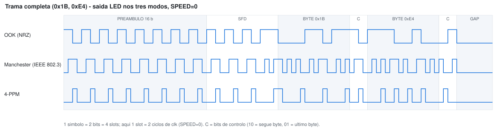

# Transmissor LiFi digital reconfigurável (Tiny Tapeout, SKY130)

ASIC que recebe bytes de 8 bits e os converte num sinal digital modulado para um LED (visível ou
infravermelho) através de um driver externo. A modulação escolhe-se por pinos: **OOK**,
**Manchester** ou **4‑PPM**, com uma 4.ª configuração reservada. Há 8 débitos e uma trama com
preâmbulo, SFD e bits de controlo, para que um recetor externo identifique o início e o fim de
cada transmissão.

| | |
|---|---|
| Topo | `tt_um_duarte_diamantino_lifi_tx` (`src/project.v`) |
| Débito | `f_clk / 4^(SPEED+1)`: 2,5 Mbit/s … 153 bit/s a 10 MHz |
| Área | 314 células sky130, 66 FF, 2611 µm² ≈ 16 % de **1 tile** |
| Testes | sistema (Fases 1–8), unitários, cocotb TT, pós-síntese genérica e sky130, Wokwi ≡ RTL; 14/14 mutações detetadas |



## Início rápido (WSL2)

```bash
bash tools/install_tools_wsl.sh   # uma vez: OSS CAD Suite + liberty sky130 (sem sudo)
cadenv                            # ativa as ferramentas neste terminal
make all                          # lint, testes, VCD, síntese, área, pós-síntese, Wokwi
make cocotb                       # testes do template Tiny Tapeout
gtkwave waves/ppm.vcd waves/demo.gtkw
```

Guia completo para Windows 11: [docs/WSL2.md](docs/WSL2.md).

## Documentação

| Documento | Conteúdo |
|---|---|
| [docs/DESIGN.md](docs/DESIGN.md) | Especificação: diagrama de blocos, mapa de pinos, convenções temporais, diagramas temporais, protocolo de trama, handshake, máquina de estados, verificação, área, fases |
| [docs/info.md](docs/info.md) | Folha de dados Tiny Tapeout (inglês) |
| [docs/WSL2.md](docs/WSL2.md) | Instalação e utilização no Windows 11 + WSL2, submissão ao TT |
| [docs/WOKWI.md](docs/WOKWI.md) | Investigação Wokwi e versão gráfica simplificada |

## Estrutura

```
info.yaml                 metadados Tiny Tapeout (yaml_version 6, 1x1, 10 MHz)
src/                      RTL sintetizável + config.json (LibreLane, template TT)
  project.v               wrapper tt_um_duarte_diamantino_lifi_tx (pinos, uio_oe)
  lifi_tx_core.v          integração + registo de saída
  lifi_input_if.v         sincronizador LOAD, registo de entrada, aceita/rejeita
  lifi_shiftreg.v         shift register 8 b
  lifi_clkdiv.v           divisor configurável
  lifi_symtimer.v         temporizador de símbolos
  lifi_ctrl_fsm.v         FSM + enquadramento
  lifi_modulators.v       OOK, Manchester, 4-PPM, mux
sim/                      testbenches Verilog auto-verificáveis
test/                     testes cocotb do template TT (correm no CI, RTL e gate-level)
synth/                    scripts Yosys (genérico e sky130) + relatório de área
waves/                    VCD de demonstração + configurações GTKWave (.gtkw)
wokwi/                    diagram.json simplificado, conversor e testbench de equivalência
docs/                     documentação + diagramas SVG gerados da simulação
tools/                    instalação das ferramentas no WSL
.github/workflows/        gds.yaml e test.yaml do template TT (ttsky26d)
```

## Submissão

Este repositório foi criado a partir de https://github.com/TinyTapeout/ttsky-verilog-template
(workflows do shuttle SKY aberto) e o topo já tem nome único (`tt_um_duarte_diamantino_lifi_tx`).

1. Confirma em *Actions* que `gds`, `test` e `docs` ficam verdes (área e timing reais).
2. Quando houver um shuttle SKY130 aberto que te sirva, submete em https://app.tinytapeout.com
   (ou altera uma submissão existente com o guia *Change your submitted project repository*).
3. Para um shuttle IHP ou GF, cria um repositório novo a partir do template dessa tecnologia e
   copia `src/`, `test/`, `docs/` e `info.yaml`; a área muda e tem de ser medida de novo.

Licença: Apache-2.0 (identificador SPDX em cada ficheiro, ficheiro `LICENSE` do template).
