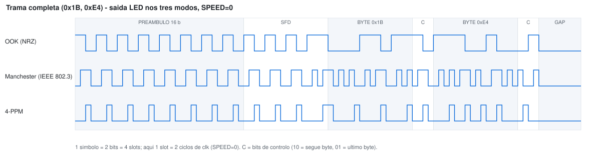
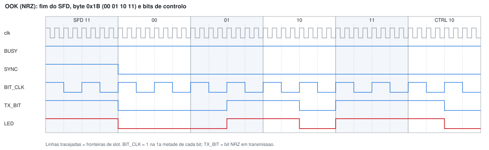
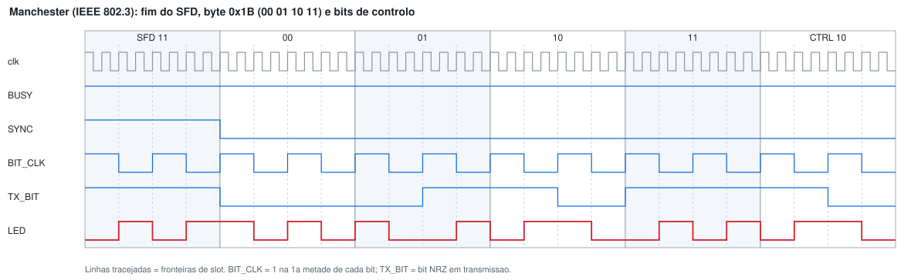
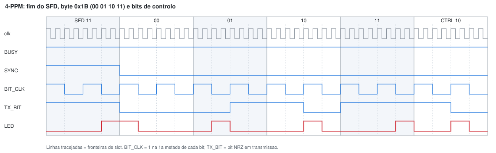
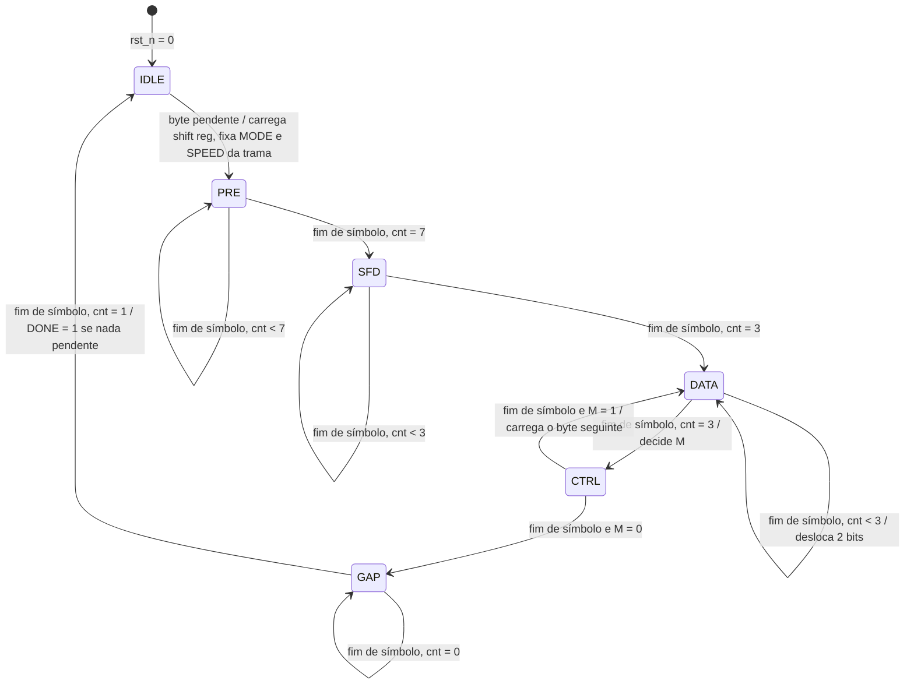

# Transmissor LiFi digital reconfigurável — especificação e arquitetura

ASIC para Tiny Tapeout (SKY130, 1 tile) que recebe bytes de 8 bits e gera o sinal
digital modulado que comanda um LED através de um **driver externo**. A modulação
(OOK, Manchester ou 4‑PPM) e o débito (8 velocidades) escolhem-se por pinos, sem
alterar o hardware. Os bytes são tratados como dados binários arbitrários (não há
descodificação ASCII).

| | |
|---|---|
| Módulo de topo | `tt_um_duarte_diamantino_lifi_tx` (renomear com o teu utilizador GitHub antes de submeter) |
| Relógio de referência | 10 MHz (funciona com qualquer relógio até 50 MHz, o período de timing do template) |
| Débito binário | `R_b = f_clk / 4^(SPEED+1)` → 2,5 Mbit/s … 153 bit/s a 10 MHz |
| Área estimada | 314 células sky130_fd_sc_hd, 66 flip-flops, 2611 µm² ≈ 16 % do core de 1 tile |
| Verificação | testbench de sistema auto-verificável, testes unitários, cocotb (CI do TT), simulação pós-síntese, 14/14 mutações detetadas |

---

## 1. Decisões de arquitetura

1. **Grelha temporal comum.** Tudo deriva de um *slot* de `N_slot` ciclos de relógio.
   1 bit = 2 slots; 1 símbolo = 2 bits = 4 slots. Assim **as três modulações têm o mesmo
   débito binário** para a mesma `SPEED`, e cada modulador é uma função combinacional pura de
   `(dibit, slot)`: poucas portas, fácil de verificar exaustivamente.
2. **4‑PPM em vez de 2‑PPM.** 2‑PPM (impulso na 1.ª ou 2.ª metade do bit) é idêntico a
   Manchester. A 4‑PPM (como no IrDA FIR) transporta 2 bits por símbolo com um único impulso
   de 1 slot: ciclo de trabalho de 25 %, a modulação mais eficiente em potência ótica.
3. **Configuração capturada com cada byte.** `MODE`, `SPEED` e `LAST` são amostrados no mesmo
   instante que `DATA`, no flanco de `LOAD`. Como os pinos já estão estáveis nesse instante,
   não há metaestabilidade nem combinações incoerentes de bits. A configuração de uma trama é a
   do seu 1.º byte; um byte com configuração diferente **fecha a trama e abre outra**, pelo que
   mudar de modo ou de velocidade nunca corrompe dados em trânsito.
4. **Sem perda silenciosa de dados.** Há um buffer de 2 bytes (registo de entrada + registo de
   deslocamento). Um `LOAD` com o registo cheio, ou no modo reservado, é **rejeitado**: o byte
   guardado não é sobrescrito e `ERR` sobe. `READY` indica quando se pode carregar.
5. **Saídas registadas.** Todas as saídas passam por um registo final: não há glitches no LED e
   todas ficam alinhadas (o 1.º slot da trama aparece no ciclo em que `BUSY` sobe).
6. **Reset síncrono** (`rst_n`, ativo a 0) em todos os registos, incluindo os de dados: o estado
   é sempre determinístico, mesmo em simulação gate-level.
7. **Modo 11 reservado.** Tem uma entrada própria no multiplexador (`in_rsv`, hoje ligada a 0). Um
   `LOAD` com `MODE=11` é rejeitado com `ERR=1`, por isso nada é transmitido nem perdido em silêncio.

---

## 2. Diagrama de blocos

```mermaid
flowchart LR
  subgraph PIN_IN["Pinos de entrada"]
    DATA["ui_in[7:0] DATA"]
    CFG["uio[1:0] MODE · uio[5:3] SPEED · uio[6] LAST"]
    LOAD["uio[2] LOAD (assíncrono)"]
  end

  LOAD --> SYNC["Sincronizador 2 FF + detetor de flanco"]
  SYNC --> IF
  DATA --> IF
  CFG --> IF
  IF["Registo de entrada 8 b + config<br/>lifi_input_if<br/>(aceita / rejeita, ERR)"]
  IF -- "hold_data" --> SR["Shift register 8 b<br/>lifi_shiftreg<br/>(2 bits por símbolo, MSB 1.º)"]
  IF -- "hold_valid, modo, vel., LAST" --> FSM
  FSM["FSM de controlo + enquadramento<br/>lifi_ctrl_fsm<br/>IDLE·PRE·SFD·DATA·CTRL·GAP<br/>contador de símbolos"]
  FSM -- "consume" --> IF
  FSM -- "load / shift" --> SR
  SR -- "dibit" --> FSM
  FSM -- "run, speed_q" --> DIV["Divisor configurável<br/>lifi_clkdiv<br/>N_slot = 2·4^SPEED"]
  DIV -- "tick" --> TIM["Temporizador de símbolos<br/>lifi_symtimer<br/>slot 0..3"]
  TIM -- "sym_end" --> FSM
  FSM -- "sym[1:0]" --> OOK["Modulador OOK"]
  FSM -- "sym[1:0]" --> MAN["Modulador Manchester"]
  FSM -- "sym[1:0]" --> PPM["Modulador 4-PPM"]
  TIM -- "slot[1:0]" --> OOK
  TIM -- "slot[1:0]" --> MAN
  TIM -- "slot[1:0]" --> PPM
  OOK --> MUX["Mux de modulação<br/>lifi_mod_mux<br/>11 = reservado"]
  MAN --> MUX
  PPM --> MUX
  FSM -- "mode_q" --> MUX
  MUX --> OREG["Registo de saída<br/>(sem glitches)"]
  FSM -- "on_air, sync, done" --> OREG
  OREG --> OUT["uo[0] LED · uo[7] LED_N · uo[1] BUSY · uo[2] READY<br/>uo[3] DONE · uo[4] ERR · uo[5] BIT_CLK · uo[6] SYNC · uio[7] TX_BIT"]
  OUT --> DRV["Driver de LED externo<br/>(MOSFET / driver dedicado)"]
```



Versão em texto (igual à do datasheet):

```
 ui_in[7:0] ─┐   ┌────────────────┐ hold_data ┌──────────────┐ dibit
 MODE/SPEED ─┼──►│ registo entrada├──────────►│ shift reg 8b ├─────┐
 LAST ───────┘   │  + config      │           └──────▲───────┘     │
 LOAD ─►[sync]──►│ aceita/rejeita │                  │load/shift   ▼
                 └───┬────────▲───┘            ┌─────┴───────────────────┐
                     │valid   │consume         │ FSM controlo + trama    │
                     └────────┼───────────────►│ IDLE PRE SFD DATA CTRL  │
                              └────────────────┤ GAP · contador simbolos │
                                               └──┬─────▲──────┬─────────┘
                                       run,speed  │     │sym_end│ sym[1:0], mode_q
                                    ┌─────────────▼┐  ┌─┴──────┴──┐
                                    │ divisor clk  ├─►│ temporiz. │ slot[1:0]
                                    │ N=2·4^SPEED  │  │ simbolos  ├──────┐
                                    └──────────────┘  └───────────┘      ▼
                                          ┌─────┐ ┌──────────┐ ┌──────┐
                                          │ OOK │ │Manchester│ │4-PPM │  (+ reservado)
                                          └──┬──┘ └────┬─────┘ └──┬───┘
                                             └────► MUX ◄─────────┘
                                                     │
                                              [registo de saida] ──► LED, LED_N, estado
```

---

## 3. Mapa de pinos Tiny Tapeout

| Pino | Dir. | Sinal | Descrição |
|---|---|---|---|
| `ui[7:0]` | in | `DATA[7:0]` | Byte a transmitir (binário arbitrário), amostrado no flanco de `LOAD` |
| `uo[0]` | out | `LED` | **Sinal modulado** para o driver do LED (1 = LED aceso). Em repouso: 0 |
| `uo[1]` | out | `BUSY` | Trama em curso (do 1.º slot do preâmbulo até ao fim do GAP) |
| `uo[2]` | out | `READY` | Registo de entrada livre: um `LOAD` agora é aceite |
| `uo[3]` | out | `DONE` | Tudo transmitido: a última trama terminou sem bytes pendentes. Limpa no `LOAD` aceite seguinte |
| `uo[4]` | out | `ERR` | O último `LOAD` foi rejeitado (registo cheio ou `MODE=11`). Limpa no `LOAD` aceite seguinte |
| `uo[5]` | out | `BIT_CLK` | Diagnóstico: 1 na 1.ª metade de cada bit durante a trama (trigger de osciloscópio) |
| `uo[6]` | out | `SYNC` | Diagnóstico: preâmbulo + SFD em curso |
| `uo[7]` | out | `LED_N` | `LED` invertido: driver ativo a 0 ou modulação invertida "LED normalmente aceso" (I‑PPM) |
| `uio[1:0]` | in | `MODE[1:0]` | 00 OOK · 01 Manchester · 10 4‑PPM · 11 reservado |
| `uio[2]` | in | `LOAD` | Flanco ascendente = carregar `DATA` + configuração |
| `uio[5:3]` | in | `SPEED[2:0]` | Velocidade (tabela 4.2) |
| `uio[6]` | in | `LAST` | 1 = este byte fecha a trama |
| `uio[7]` | **out** | `TX_BIT` | Diagnóstico: bit NRZ a ser transmitido (antes da modulação) |

`uio_oe = 8'b1000_0000`: `uio[6:0]` são entradas (output enable = 0) e `uio[7]` é saída.
`ena` não é usado. `rst_n` = reset síncrono ativo a 0.

---

## 4. Convenções temporais

### 4.1 Hierarquia de tempos

```
clk ──► slot = N_slot ciclos ──► bit = 2 slots ──► símbolo = 2 bits = 4 slots
                                  (metade 0 | metade 1)   (bit MSB | bit LSB)
```

Dentro de um símbolo, `slot[1]` indica qual dos dois bits está a ser enviado (0 = o mais
significativo) e `slot[0]` indica a metade do bit. Os bytes são enviados **MSB primeiro**, em
4 símbolos: `d7d6`, `d5d4`, `d3d2`, `d1d0`.

### 4.2 Velocidades (`SPEED`)

`N_slot = 2·4^SPEED` ciclos, `T_bit = 2·N_slot = 4^(SPEED+1)` ciclos, `R_b = f_clk / 4^(SPEED+1)`.

| SPEED | N_slot (clk) | T_bit (clk) | R_b @ 10 MHz | R_b @ 50 MHz | Impulso mínimo¹ @ 10 MHz |
|---:|---:|---:|---:|---:|---:|
| 0 | 2 | 4 | 2,5 Mbit/s | 12,5 Mbit/s | 200 ns |
| 1 | 8 | 16 | 625 kbit/s | 3,125 Mbit/s | 800 ns |
| 2 | 32 | 64 | 156,25 kbit/s | 781 kbit/s | 3,2 µs |
| 3 | 128 | 256 | 39,06 kbit/s | 195 kbit/s | 12,8 µs |
| 4 | 512 | 1 024 | 9 766 bit/s | 48,8 kbit/s | 51,2 µs |
| 5 | 2 048 | 4 096 | 2 441 bit/s | 12,2 kbit/s | 205 µs |
| 6 | 8 192 | 16 384 | 610 bit/s | 3 052 bit/s | 819 µs |
| 7 | 32 768 | 65 536 | 152,6 bit/s | 763 bit/s | 3,28 ms |

¹ Largura mínima de um impulso do LED em Manchester e 4‑PPM (1 slot). Em OOK o impulso mínimo é
1 bit (2 slots), por isso, para a mesma largura de banda do LED e do fotodetetor, o OOK pode
correr ao dobro do débito. As velocidades em potências de 4 cobrem quatro ordens de grandeza
com um divisor sem comparador; para débitos "redondos" (p.ex. 9600 bit/s) escolhe-se o relógio:
`f_clk = R_b · 4^(SPEED+1)` (9600 bit/s com SPEED=4 → 9,8304 MHz, que o RP2040 da placa de
demonstração consegue gerar).

### 4.3 Mapeamento dos bits em cada modulação

Forma de onda dos 4 slots de um símbolo (slot 0 à esquerda; 1 = LED aceso):

| dibit | OOK (NRZ) | Manchester (IEEE 802.3) | 4‑PPM |
|:---:|:---:|:---:|:---:|
| 00 | `0000` | `1010` | `1000` |
| 01 | `0011` | `1001` | `0100` |
| 10 | `1100` | `0110` | `0010` |
| 11 | `1111` | `0101` | `0001` |

| | OOK | Manchester | 4‑PPM |
|---|---|---|---|
| Regra | bit 1 = LED aceso o bit inteiro | **1 = baixo→alto**, 0 = alto→baixo a meio do bit (IEEE 802.3; o recetor tem de usar a mesma convenção, G. E. Thomas é a oposta) | 1 impulso de 1 slot por símbolo, na posição igual ao valor do dibit (00→slot 0 … 11→slot 3) |
| Bits/símbolo | 2 (2 bits NRZ) | 2 | 2 |
| Brilho médio na trama | depende dos dados (≈50 %) | 50 % exato | 25 % (75 % em `LED_N`) |
| Impulso mínimo | `T_bit` | `T_bit/2` | `T_bit/2` |
| Relógio embutido | não: transições garantidas pelo enquadramento (≤ 11 bits sem transição) | sim: transição a meio de cada bit | sim: um impulso em cada símbolo (≤ 6 slots sem impulso) |
| Deteção de erros na linha | não há violações possíveis | metades iguais = violação | 0 ou ≥ 2 impulsos = violação |

### 4.4 Requisitos de sincronização do recetor

* **Débito**: o recetor tem de conhecer `MODE` e `SPEED` (combinados à partida, tal como a
  velocidade de uma UART). Tolerância de relógio recomendada ≤ ±2 % em OOK (que, como uma UART,
  depende das transições) e ≤ ±5 % em Manchester/4‑PPM com ressincronização nas transições.
* **Fase de bit**: obtida no preâmbulo.
  OOK: flancos nas fronteiras de bit (onda quadrada de período 2 bits).
  Manchester: flancos **apenas** a meio do bit, o que dá uma referência sem ambiguidade.
  4‑PPM: um impulso por símbolo, sempre no slot 2.
* **Fase de símbolo (4‑PPM)**: por convenção, os impulsos do preâmbulo estão no **slot 2**. O
  recetor alinha a fronteira de símbolo 2 slots antes de cada impulso. O SFD confirma-o, porque o
  impulso passa para o slot 3.
* **Fronteira de byte**: o 1.º bit de dados vem imediatamente a seguir ao `11` do SFD. A partir
  daí há sempre 10 bits por byte (8 de dados + 2 de controlo).

---

## 5. Diagramas temporais

Gerados automaticamente a partir dos VCD da simulação (`make waves` corre
`docs/gen_timing_svg.py`). Trama com 2 bytes, `0x1B` e `0xE4`, em `SPEED=0` (1 slot = 2 ciclos).
Os dois bytes cobrem os quatro dibits.

**Trama completa nos três modos**



**OOK**: fim do SFD, byte `0x1B` = `00 01 10 11` e controlo `10` (segue outro byte)



**Manchester**



**4‑PPM**



Forma de onda do LED símbolo a símbolo (saída de `make waves`):

```
símbolo  secção       OOK    Manchester  4-PPM
  0-7    PREÂMBULO    1100   0110        0010     (bits 10, repetidos 8x)
  8-10   SFD          1100   0110        0010     (10 10 10)
  11     SFD          1111   0101        0001     (11  <- início dos dados a seguir)
  12     0x1B d7d6    0000   1010        1000     (00)
  13     0x1B d5d4    0011   1001        0100     (01)
  14     0x1B d3d2    1100   0110        0010     (10)
  15     0x1B d1d0    1111   0101        0001     (11)
  16     CTRL         1100   0110        0010     (10 = segue outro byte)
  17-20  0xE4         1111 1100 0011 0000 / ...    (11 10 01 00)
  21     CTRL         0011   1001        0100     (01 = último byte)
  22-23  GAP          0000   0000        0000     (LED apagado, BUSY=1)
```

---

## 6. Protocolo de enquadramento e sincronização

### 6.1 Formato da trama

```
 ┌───────────────┬──────────┬───────────┬──────┬───────────┬──────┬─────┬──────┬─────────┐
 │ PREÂMBULO     │ SFD      │ BYTE 0    │ CTRL │ BYTE 1    │ CTRL │ ... │ CTRL │ GAP     │
 │ 16 b: 1010..10│ 10101011 │ d7 ... d0 │ M ~M │ d7 ... d0 │ M ~M │     │ 0 1  │ 4 b = 0 │
 └───────────────┴──────────┴───────────┴──────┴───────────┴──────┴─────┴──────┴─────────┘
   8 símbolos      4 simb.    4 símb.     1      4            1            1      2 símb.
```

| Campo | Bits | Conteúdo | Função |
|---|---:|---|---|
| Preâmbulo | 16 | `10` × 8 | Controlo automático de ganho/limiar no recetor e recuperação de relógio (fase de bit e de símbolo) |
| SFD | 8 | `10101011` (0xAB, MSB 1.º) | O `11` final marca o início dos dados. É o mesmo princípio do SFD Ethernet |
| Dados | 8 | byte, MSB primeiro | Binário arbitrário |
| Controlo | 2 | `M ~M` | `10` = segue-se outro byte nesta trama; `01` = último byte. `00`/`11` são inválidos (deteção de erro) e há **sempre** uma transição dentro do campo |
| GAP | 4 | LED apagado | Guarda entre tramas: o recetor volta ao estado de procura do preâmbulo |

**Início da transmissão** = preâmbulo + SFD. **Fim** = byte com controlo `01`, seguido do GAP
(LED apagado; em Manchester e PPM, a ausência de transições/impulsos é ela própria uma violação
de código que confirma o fim).

Duração de uma trama com `n` bytes: `(14 + 5n) · 4 · N_slot` ciclos de relógio
(= `28 + 10n` períodos de bit). Eficiência = `8n / (28 + 10n)`: 21 % (n = 1), 59 % (n = 8),
77 % (n = 64), no limite 80 %.

### 6.2 Quando é que a trama continua (`M = 1`)

`M` é decidido no início do campo de controlo de cada byte:

```
M = (há um byte à espera no registo de entrada)
    E (o byte atual não foi carregado com LAST=1)
    E (o byte à espera tem o mesmo MODE e SPEED da trama)
```

Consequências:
* **Anfitrião rápido** (carrega o byte seguinte antes do fim dos 8 bits do atual): todos os bytes
  ficam numa só trama até `LAST`.
* **Anfitrião lento**: a trama fecha e o byte seguinte abre uma nova trama com preâmbulo. Não se
  perdem dados, só se perde eficiência.
* **`LAST=1`**: fecha a trama mesmo que haja mais bytes. Serve para delimitar mensagens.
* **Mudança de `MODE`/`SPEED` entre bytes**: fecha a trama; a seguinte usa a nova configuração.

### 6.3 Algoritmo de receção (referência)

É o que fazem o recetor do testbench (`sim/tb_lifi_tx.v`) e o de `test/test.py`:

```
1. Repouso: esperar pelo 1.º '1' do LED (OOK: slot 0; Manchester: slot 1; PPM: slot 2 do símbolo).
2. Alinhar a grelha de slots/símbolos com esse flanco; amostrar o LED a meio de cada slot.
3. Desmodular símbolo a símbolo:
     OOK         dibit = {s0, s2}   (exige s0=s1, s2=s3)
     Manchester  dibit = {s1, s3}   (exige s0≠s1, s2≠s3)
     4-PPM       dibit = posição do único '1'
4. Exigir 11 x '10' e depois '11' (preâmbulo + SFD). Senão, voltar a 1.
5. Repetir: 4 símbolos -> byte; 1 símbolo -> controlo. '10' continua, '01' termina, outro valor = erro.
6. Verificar o GAP (LED apagado) e voltar a 1.
```

Num recetor real, o passo 2 faz-se com recuperação de relógio (PLL digital ou ressincronização
em cada flanco), usando o preâmbulo para convergir.

---

## 7. Interface com o anfitrião (carregamento e handshake)

```
            ┌───────────────── dados e config. estáveis ─────────────────┐
 DATA/CFG ══╡ byte k                                                     ╞══════
            └────────────────────────────────────────────────────────────┘
 LOAD     ____/‾‾‾‾‾‾‾‾‾‾‾‾‾‾‾‾‾‾‾‾\________________   (≥ 4 ciclos em 1, ≥ 3 em 0)
 clk       |0 |1 |2 |3 |4 |5 |6 |
 aceite                 ^E3: byte e configuração copiados para o registo de entrada
 READY    ‾‾‾‾‾‾‾‾‾‾‾‾‾‾‾‾‾\_ ...   (desce em E4 se o registo ficar ocupado)
 ERR/DONE limpam em E4
 BUSY / 1.º slot do LED: E5 (se o transmissor estava em repouso)
```

* `LOAD` é sincronizado (2 FF) e atua no **flanco ascendente**: mantê-lo em 1 muito tempo não
  carrega o byte duas vezes.
* `DATA`, `MODE`, `SPEED` e `LAST` têm de estar estáveis enquanto `LOAD=1`. O byte é amostrado
  2–3 ciclos depois do flanco de `LOAD`.
* Latência de `LOAD` ao 1.º slot do LED (transmissor em repouso): 5 ciclos.
* `READY=1`: o registo de entrada está livre. Com o transmissor em repouso, o byte passa logo para
  o registo de deslocamento e `READY` volta a 1 um ciclo depois. Durante uma trama, `READY` só
  volta a 1 quando o byte em espera começa a ser transmitido.
* `ERR=1`: o último `LOAD` foi rejeitado (registo cheio ou `MODE=11`). O byte guardado mantém-se
  intacto. Volta a 0 no próximo `LOAD` aceite.
* `DONE=1`: a última trama terminou e não há bytes pendentes. Sobe no mesmo ciclo em que `BUSY`
  desce e volta a 0 no próximo `LOAD` aceite. Depois do reset vale 0.

Pseudo-código do anfitrião (p.ex. RP2040 da placa de demonstração):

```python
for i, b in enumerate(mensagem):
    while not READY: pass                     # buffer livre?
    ui_in  = b
    uio_in = (LAST if i == len(mensagem)-1 else 0) << 6 | SPEED << 3 | MODE
    uio_in |= 1 << 2; espera(4 ciclos); uio_in &= ~(1 << 2)   # impulso LOAD
    assert not ERR
while not DONE: pass                          # mensagem toda no ar
```

---

## 8. Máquina de estados



| Estado | Símbolos | Símbolo enviado (`sym`) | LED | `BUSY` | `SYNC` | Ação no fim |
|---|---:|---|---|:---:|:---:|---|
| `IDLE` | — | — | 0 | 0 | 0 | Se `hold_valid`: carrega shift register, fixa `mode_q`/`speed_q`/`cur_last`, liberta o registo de entrada |
| `PRE` | 8 | `10` | modulado | 1 | 1 | → `SFD` |
| `SFD` | 4 | `10 10 10 11` | modulado | 1 | 1 | → `DATA` |
| `DATA` | 4 | `sr[7:6]` (desloca 2 bits/símbolo) | modulado | 1 | 0 | `M ← hold_valid ∧ ¬cur_last ∧ (config igual)` → `CTRL` |
| `CTRL` | 1 | `{M, ¬M}` | modulado | 1 | 0 | `M=1`: carrega o byte seguinte → `DATA`; `M=0` → `GAP` |
| `GAP` | 2 | — | 0 | 1 | 0 | → `IDLE`; `DONE ← 1` se o registo de entrada estiver vazio |

O contador de símbolos `cnt` tem 3 bits. O fim de símbolo (`sym_end`) é o *tick* do divisor
com `slot = 3`. `rst_n = 0` leva qualquer estado a `IDLE` e descarta o byte pendente.

---

## 9. Estrutura do RTL

| Ficheiro | Módulo(s) | Função | Área sky130¹ |
|---|---|---|---:|
| `src/project.v` | `tt_um_duarte_diamantino_lifi_tx` | Wrapper TT: mapa de pinos e `uio_oe` | — |
| `src/lifi_tx_core.v` | `lifi_tx_core` | Integração + registo de saída | 223 µm² |
| `src/lifi_input_if.v` | `lifi_input_if` | Sincronizador de `LOAD`, registo de entrada 8 b + config, aceita/rejeita, `ERR` | 677 µm² |
| `src/lifi_shiftreg.v` | `lifi_shiftreg` | Registo de deslocamento 8 b (2 bits/símbolo) | 358 µm² |
| `src/lifi_clkdiv.v` | `lifi_clkdiv` | Divisor configurável (contador de 15 b, tick por máscara) | 617 µm² |
| `src/lifi_symtimer.v` | `lifi_symtimer` | Contador de slots 0..3, fim de símbolo | 73 µm² |
| `src/lifi_ctrl_fsm.v` | `lifi_ctrl_fsm` | FSM, contador de símbolos, enquadramento, decisão `M`, `DONE` | 751 µm² |
| `src/lifi_modulators.v` | `lifi_mod_ook`, `lifi_mod_manchester`, `lifi_mod_ppm`, `lifi_mod_mux` | Moduladores combinacionais + mux | 74 µm² |

¹ Síntese hierárquica (sem achatar), `build/synth_sky130_hier.txt`. A síntese achatada otimiza
entre blocos e dá 2611 µm² no total.

---

## 10. Verificação

| Nível | Ficheiro | Comando | Resultado |
|---|---|---|---|
| Lint | Verilator `-Wall` | `make lint` | 0 avisos |
| Unitário: moduladores (fases 1, 3, 4) | `sim/tb_modulators.v` | `make unit` | 76 verificações contra tabelas escritas à mão |
| Unitário: divisor + temporizador (fase 5) | `sim/tb_timebase.v` | `make unit` | 8 velocidades, período de tick e de símbolo exatos |
| Sistema (fases 1–8) | `sim/tb_lifi_tx.v` | `make sim` | **PASS**: 311 tramas, 1148 bytes, 4,5 M ciclos |
| Demonstração / diagramas | `sim/tb_waves.v` | `make waves` | VCD + SVG por modulação |
| Pós-síntese (genérico) | netlist Yosys + `simcells.v` | `make gl` | **PASS** (mesmo testbench) |
| Pós-síntese (sky130) | netlist sky130 + modelos da liberty | `make gl-sky130` | **PASS** |
| CI Tiny Tapeout | `test/test.py` (cocotb 2.1) | `make cocotb` | 5/5 PASS (RTL; o CI corre também em gate-level) |
| Wokwi | `wokwi/tb_wokwi.v` | `make wokwi` | 192 verificações: circuito Wokwi ≡ RTL |
| Wokwi (no site) | `wokwi/diagram.json` no template TT | manual, ver `docs/WOKWI.md` | 512 verificações no simulador Wokwi, 0 erros |
| Wokwi (exportação) | `wokwi/tt_um_wokwi_481391130244247553.v` | `make wokwi-export` | Verilog exportado pela Wokwi: lint OK, 15 células, 192 verificações ≡ RTL |
| Qualidade do testbench | `sim/mutation_test.sh` | `make mutation` | 14/14 bugs injetados detetados |

**Testbench de sistema.** O recetor de referência vê **apenas o LED** (e conhece o modo e a
velocidade combinados). Deteta o preâmbulo, desmodula, valida o SFD, os bits de controlo e o GAP, e
compara cada byte com o *scoreboard*. Verifica ainda, ciclo a ciclo:
* que cada slot dura exatamente `N_slot` ciclos e que as saídas são constantes dentro do slot;
* que `BUSY` sobe no 1.º slot e desce exatamente `(14+5n)·4·N_slot` ciclos depois;
* `SYNC`, `BIT_CLK` e `TX_BIT` coerentes com o símbolo descodificado;
* invariantes globais: `LED_N = ¬LED`, `uio_oe = 0x80`, `DONE` nunca sobe com bytes pendentes,
  `ERR` nunca sobe sem um `LOAD` ilegal.

| Teste | O que verifica |
|---|---|
| T0 reset | Valores de todas as saídas durante e após o reset |
| F1 OOK um bit | Bytes `0x80` e `0x01` (um único bit a 1) |
| F2/F3/F4 | 8 bytes (`00 FF A5 5A 3C C3 1B E4`) numa única trama em OOK, Manchester e 4‑PPM |
| 256 valores | Todos os valores de byte nos 3 modos |
| F5 velocidades | SPEED 0–7 (os 3 modos em 0–2), duração exata de bit |
| F6 enquadramento | `LAST` divide tramas [2,2]; anfitrião lento → 1 byte/trama; byte que chega depois da decisão `M` → nova trama, sem perda e sem `DONE` prematuro |
| F7 mudança de modo | Modo/velocidade diferentes entre bytes → 4 tramas; pinos `MODE`/`SPEED`/`LAST` a mudar ao acaso durante `BUSY` sem efeito na trama em curso |
| F8 busy/overrun | `LOAD` com registo cheio rejeitado (`ERR`) sem corromper dados; modo 11 rejeitado; `LOAD` mantido 300 ciclos carrega 1 só byte |
| Reset a meio | Reset durante a transmissão → saídas em repouso, sem atividade residual, recuperação |
| Aleatório | 300 bytes com modo, velocidade, `LAST` e atrasos aleatórios (`+seed=N`) |

**Testes de mutação.** Para confirmar que o testbench deteta erros reais, injetaram-se 14 bugs
no RTL, um de cada vez. Todos foram detetados: Manchester invertido, PPM com slots trocados, SFD
sem `11`, preâmbulo curto, GAP curto, mudança de configuração ignorada, `LAST` ignorado, `DONE`
com byte pendente, registo de entrada sobrescrito, modo reservado aceite, divisor errado,
MSB/LSB trocados, `BIT_CLK` invertido e LED ativo durante o GAP.

---

## 11. Síntese e área

`make synth-sky130` (Yosys 0.71 + ABC, biblioteca `sky130_fd_sc_hd`, canto tt 25 °C 1,8 V):

| Métrica | Valor |
|---|---|
| Células padrão | 314 (66 flip-flops `dfxtp_1`) |
| Área de células | 2611 µm² (50 % em flip-flops) |
| Tile 1x1 (161,00 × 111,52 µm) | core ≈ 16 493 µm² → **utilização ≈ 16 %** |
| Densidade-alvo de colocação do template | 60 % |
| Caminho combinacional mais longo | 7 células (contador do divisor → FSM) |

**Cabe num tile 1x1 com folga larga.** A estimativa é anterior ao layout. O LibreLane acrescenta
árvore de relógio, células de tap/decap, buffers de hold e díodos de antena, que tipicamente
somam 10–30 % à área de células. Mesmo assim a utilização fica muito abaixo dos 60 %. A
confirmação final é o *GDS action* do repositório Tiny Tapeout, que reporta a utilização real e
o timing.

Onde está a área: o registo de entrada com a sua configuração (19 FF), o divisor de 15 bits e
a FSM são cerca de três quartos do total. Se fosse preciso poupar, as opções seriam: reduzir as
velocidades para 4 (divisor de 7 bits, −8 FF) ou dispensar o *reset* nos registos de dados.

---

## 12. Metodologia por fases

| Fase | Entregável | Onde no projeto | Teste |
|---|---|---|---|
| 1. OOK com um único bit | Modulador OOK + temporizador | `lifi_mod_ook`, `lifi_symtimer` | `tb_modulators` (secção F1), F1 em `tb_lifi_tx` |
| 2. Bytes de 8 bits | Registo de entrada, shift register, contador de símbolos, FSM `DATA` | `lifi_input_if`, `lifi_shiftreg`, `lifi_ctrl_fsm` | F2, 256 valores |
| 3. Manchester | Modulador Manchester + mux | `lifi_mod_manchester`, `lifi_mod_mux` | `tb_modulators`, F3 |
| 4. PPM | Modulador 4‑PPM | `lifi_mod_ppm` | `tb_modulators`, F4 |
| 5. Velocidade | Divisor configurável | `lifi_clkdiv` | `tb_timebase`, F5 |
| 6. Enquadramento | Preâmbulo, SFD, controlo, GAP, `LAST`, `DONE` | `lifi_ctrl_fsm` | F6, F7 |
| 7. Fluxo Tiny Tapeout | Wrapper, `info.yaml`, `test/` cocotb, workflows | `src/project.v`, `info.yaml`, `test/` | `make cocotb` |
| 8. Síntese e fabrico | Scripts Yosys, área, pós-síntese | `synth/`, `Makefile` | `make synth-sky130 gl gl-sky130` |

---

## 13. Hardware externo

**O ASIC não contém driver de potência.** Cada pino TT fornece no máximo ~4 mA a 3,3 V (pads
`sky130_ef_io_gpiov2`, saída até ~33 MHz). Isto chega para atacar a gate de um transístor, não
um LED de iluminação.

* **Driver simples (≤ ~1 Mbit/s)**: MOSFET de canal N no lado baixo, com limiar baixo e
  especificado para V_GS = 2,5 V (p.ex. AO3400), gate em `uo[0]` através de ~100 Ω e pull-down
  de 100 kΩ. O LED fica em série com uma resistência para a alimentação. `LED=1` acende o LED.
* **Débitos altos**: driver de gate dedicado ou estágio com transístor rápido, e um LED com tempo
  de subida curto (existem LEDs IR de alta velocidade, p.ex. para IrDA). Os LEDs brancos de
  fósforo têm uma largura de banda de poucos MHz por causa do fósforo; um filtro azul no recetor
  ajuda.
* **Driver ativo a 0 ou "luz normalmente acesa"**: usar `uo[7] LED_N`. Com ele, em repouso o LED
  fica aceso, Manchester dá 50 % de brilho e 4‑PPM passa a I‑PPM, com 75 % de brilho. É útil
  quando o LED também ilumina.
* **Recetor sugerido**: fotodíodo (p.ex. BPW34, ou um fotodíodo PIN para débitos altos) com
  amplificador de transimpedância, acoplamento AC/limiar adaptativo e comparador, ligado a um
  microcontrolador ou FPGA que implemente o algoritmo da secção 6.3.

Estas indicações são orientativas. Dimensiona correntes e resistências para o LED concreto que
usares e respeita os limites de segurança ocular para LEDs IR.

---

## 14. Limitações e trabalho futuro

* **Modo 11** (reservado). Candidatos: OOK compatível com UART 8N1 (o recetor passa a ser um
  fotodíodo ligado ao RX de qualquer microcontrolador), VPPM/OOK com controlo de brilho para
  iluminação, 16‑PPM, ou uma portadora de teste para alinhar a ótica.
* **Sem CRC no hardware.** Os bits de controlo `M ~M` e as violações de código detetam alguns
  erros, mas não todos. Para integridade de dados, juntar um CRC‑8/16 nos bytes da mensagem, no
  anfitrião.
* **Comprimento do preâmbulo fixo** (16 bits). Recetores com AGC lento podem precisar de mais. A
  variação seria trivial (`PRE_LAST`) e poderia ocupar o modo reservado ou um pino de configuração.
* **Buffer de 2 bytes.** A débitos altos (SPEED 0–1) um anfitrião em MicroPython não consegue
  alimentar bytes a tempo, e cada byte acaba numa trama própria. Usar o PIO do RP2040, ou uma
  velocidade menor, para obter tramas longas.
